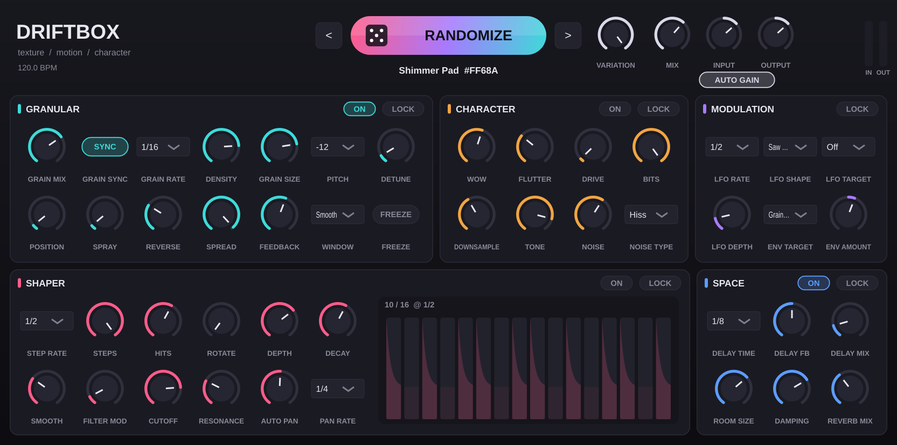

# Driftbox

Plugin de efectos para texturas, modulación rítmica y carácter analógico. Combina tres ideas:

- un motor **granular** (al estilo Output Portal),
- un **shaper rítmico** (al estilo Cableguys Shaperbox),
- una **coloración lo-fi / analógica** (al estilo XLN RC-20).



Su centro es un botón **RANDOMIZE** que crea un preset nuevo y musical cada vez que lo presionas.

| | macOS (Apple Silicon + Intel) | Windows 10/11 (64 bits) |
|---|---|---|
| Formatos | VST3, AU, Standalone | VST3, Standalone |
| Instalador | `Driftbox-1.0.0-macOS.pkg` | `Driftbox-1.0.0-Windows-Setup.exe` |

Todo está sincronizado al tempo del DAW. Eso incluye los LFO, el shaper, la tasa de granos y el delay, con divisiones rectas, tresillos y puntillos.

---

## 1. Obtener los instaladores sin instalar herramientas (recomendado)

GitHub compila el plugin gratis en Mac y Windows reales y te entrega los instaladores listos.

1. Crea una cuenta en <https://github.com> si no tienes.
2. Crea un repositorio **nuevo y privado** (por ejemplo `driftbox`).
3. Sube esta carpeta completa. Debe incluir la carpeta oculta `.github`, que es la que activa la compilación. Elige una de estas dos formas:
   - **Con GitHub Desktop** (<https://desktop.github.com>):
     1. *File → Add local repository*, elige esta carpeta y acepta crear el repositorio.
     2. Haz *Publish repository* como privado.
   - **Con la terminal**, dentro de esta carpeta:
     ```bash
     git init
     git add .
     git commit -m "Driftbox 1.0"
     git branch -M main
     git remote add origin https://github.com/TU_USUARIO/driftbox.git
     git push -u origin main
     ```
4. En GitHub entra a la pestaña **Actions**. Verás *Build Driftbox* en ejecución, que tarda unos 15–25 minutos.
5. Cuando termine con ✅, abre la ejecución y baja hasta **Artifacts**:
   - **Driftbox-macOS** trae el `.pkg` y el `.zip`.
   - **Driftbox-Windows** trae el `Setup.exe` y el `.zip`.
   - **Driftbox-Standalone-macOS** trae solo la app `Driftbox.app` para Mac, lista para abrir sin instalar (con su `LEEME.txt`).

**¿Tienes acceso a un Mac?** También puedes hacer doble clic en `scripts/build_mac_standalone.command`. Instala lo que falte y deja `Driftbox.app` en la carpeta `dist/`.

**Opcional:** si creas una etiqueta (`git tag v1.0.0 && git push --tags`), GitHub publica un *Release* con los instaladores adjuntos.

---

## 2. Instalar

### macOS
1. Haz doble clic en **`Driftbox-1.0.0-macOS.pkg`**.
2. Si macOS dice que no puede verificar el desarrollador:
   1. Abre **Ajustes del Sistema → Privacidad y seguridad**.
   2. Baja hasta el aviso de Driftbox y pulsa **Abrir de todos modos**.
   3. Vuelve a abrir el `.pkg`.

   Esto ocurre porque el plugin no está firmado con una cuenta de Apple Developer (ver sección 7).
3. El instalador deja los archivos en:
   - `/Library/Audio/Plug-Ins/VST3/Driftbox.vst3`
   - `/Library/Audio/Plug-Ins/Components/Driftbox.component` (AU, para Logic y GarageBand)
   - `/Applications/Driftbox.app`

**Alternativa sin instalador:** descomprime el `.zip`, abre Terminal en esa carpeta y ejecuta `./install_mac.sh`. Instala solo para tu usuario.

### Windows
1. Haz doble clic en **`Driftbox-1.0.0-Windows-Setup.exe`**.
2. Si aparece SmartScreen, pulsa **Más información → Ejecutar de todas formas**.
3. El instalador deja los archivos en:
   - `C:\Program Files\Common Files\VST3\Driftbox.vst3`
   - `C:\Program Files\Driftbox\Driftbox.exe` (Standalone)

**Alternativa sin instalador:** descomprime el `.zip` y haz doble clic en `install_windows.bat`.

### En tu DAW
- **Ableton Live:** *Settings → Plug-Ins → activa VST3 (y AU en Mac) → Rescan*.
- **FL Studio:** *Options → Manage plugins → Find plugins*.
- **Logic Pro:** se detecta solo. Si no aparece, abre *Plug-in Manager → Reset & Rescan Selection*.
- **Reaper:** *Preferences → Plug-ins → VST → Re-scan*.
- **Cubase / Studio One / Bitwig:** re-escanea los plugins o reinicia el programa.

Driftbox aparece como efecto del fabricante **Driftbox Audio**. Úsalo como inserto en una pista o en un bus.

---

## 3. Cómo se usa

```
IN → Granular → Character → Shaper → Space → Mix → Auto-Gain → Limitador → OUT
          ▲            ▲          ▲        ▲
          └── LFO sincronizado + seguidor de envolvente (Modulation) ──┘
```

- **RANDOMIZE:** genera un preset nuevo. Las flechas `<` `>` recorren el historial, que guarda los últimos 64.
- **VARIATION:**
  - al 100 %, cada clic genera un preset totalmente nuevo;
  - en valores bajos, *muta* el sonido actual de forma sutil.
- **LOCK** en cada módulo: el randomizer no toca ese módulo. Úsalo para conservar algo que te gustó mientras exploras el resto.
- **MIX:** mezcla entre la señal original y el efecto. La rama original está alineada en tiempo, así que no produce *phasing*.
- **AUTO GAIN:** iguala el volumen de salida con el de entrada. Así puedes comparar presets sin que gane siempre el más fuerte.

| Módulo | Qué hace |
|---|---|
| **Granular** | Graba la entrada continuamente y la reproduce en granos (hasta 64 a la vez). **Sync** los dispara al tempo; sin Sync usa **Density** en Hz. **Pitch** viene en intervalos musicales. **Feedback** realimenta los granos y crea nubes. **Freeze** congela el material. |
| **Character** | **Wow** y **Flutter** dan el vaivén de cinta. **Drive** satura con oversampling 2x. **Bits** y **Downsample** degradan en digital. **Tone** oscurece. **Noise** agrega hiss o vinilo, y se calla cuando no hay señal. |
| **Shaper** | Recorta el volumen con un patrón euclidiano (**Hits** golpes en **Steps** pasos). **Decay** da forma a cada golpe. También puede modular un filtro (**Filter Mod**) y el paneo (**Auto Pan**), todo al tempo. |
| **Space** | Delay ping-pong con tiempos musicales y reverb. |
| **Modulation** | Un LFO sincronizado (seno, triángulo, sierras, cuadrada, S&H) y un seguidor de envolvente. Cada uno puede apuntar a un parámetro: tamaño de grano, drive, tono, filtro, reverb… |

---

## 4. Cómo garantiza el Randomizer que siempre suene musical

La aleatoriedad pasa por cinco capas de reglas (`Source/random/SmartRandomizer.cpp`):

1. **Arquetipos con cadena de Markov.** Hay cinco caracteres: *Granular Cloud*, *Glitch Chop*, *Dusty Tape*, *Rhythmic Stutter* y *Shimmer Pad*. Cada uno define qué módulos se encienden y con qué rangos. La probabilidad de repetir el carácter anterior es de solo 5 %.
2. **Rangos musicales.** Cada parámetro tiene un rango "seguro", más estrecho que el total. Dentro del rango de cada arquetipo se usa una distribución triangular, así que los extremos son poco probables.
3. **Gramática rítmica según el tempo.** Cada preset elige un groove (recto, tresillo o puntillo) y todo lo rítmico lo comparte. Se descartan las divisiones demasiado rápidas al BPM actual. Los patrones son euclidianos y el tiempo fuerte está garantizado el 80 % de las veces.
4. **Reglas y presupuesto de energía.** Algunos ejemplos:
   - feedback alto limita la densidad;
   - pocos bits limitan el ruido y el drive;
   - pitch muy alto exige granos largos.

   Si la suma de los parámetros "peligrosos" pasa el presupuesto del arquetipo, el randomizer los vuelve a valores seguros.
5. **Novedad.** Cada preset se compara con los últimos 16 y, si se parece demasiado a alguno, se regenera.

En la parte de audio, el **Auto-Gain**, el **limitador con lookahead** (techo de −0,5 dBFS) y una **guardia anti-NaN** aseguran que ningún preset sature ni dañe tus parlantes.

---

## 5. Compilar en tu propio computador (opcional)

Necesitas **CMake 3.22+** y conexión a internet. JUCE 8 se descarga sola la primera vez.

**macOS:** instala las herramientas de Xcode (`xcode-select --install`) y CMake (`brew install cmake`). Luego:
```bash
cmake -B build -DCMAKE_BUILD_TYPE=Release
cmake --build build --config Release --parallel
./build/DriftboxTests_artefacts/Release/DriftboxTests     # pruebas
```

**Windows:** instala **Visual Studio 2022** (o *Build Tools*) con la carga "Desarrollo para el escritorio con C++", que ya incluye CMake. Luego, en *Developer PowerShell*:
```powershell
cmake -B build -A x64
cmake --build build --config Release --parallel
.\build\DriftboxTests_artefacts\Release\DriftboxTests.exe
```

**Solo la app Standalone para Windows, compilada desde Linux** (cross-compile; usa JUCE 7.0.12 porque JUCE 8 ya no admite MinGW):
```bash
cmake -B build-win -G Ninja -DCMAKE_BUILD_TYPE=Release -DCMAKE_TOOLCHAIN_FILE=cmake/mingw-w64-x86_64.cmake \
      -DDRIFTBOX_STANDALONE_ONLY=ON -DDRIFTBOX_BUILD_TESTS=OFF -DFETCHCONTENT_SOURCE_DIR_JUCE=/ruta/a/JUCE-7.0.12
cmake --build build-win
```

Los plugins quedan en `build/Driftbox_artefacts/Release/` (carpetas `VST3/`, `AU/` y `Standalone/`). Para crear los instaladores localmente, sigue los mismos pasos de `.github/workflows/build.yml`.

---

## 6. Estructura del proyecto

```
CMakeLists.txt                  Configuración de compilación (JUCE 8, VST3/AU/Standalone)
Source/Params.h/.cpp            Tabla única de parámetros (APVTS + metadatos del randomizer)
Source/PluginProcessor.*        Cadena de audio, modulación, historial de presets
Source/PluginEditor.*           Interfaz (generada desde la tabla de parámetros)
Source/dsp/HostClock.h          Sincronía con el DAW (AudioPlayHead, PPQ, saltos de loop)
Source/dsp/Granular.h           Motor granular
Source/dsp/Character.h          Wow/flutter, drive, bitcrush, tono, ruido
Source/dsp/Shaper.h             Volumen/filtro/paneo rítmicos
Source/dsp/Space.h              Delay sincronizado + reverb
Source/dsp/Limiter.h            Limitador con lookahead
Source/random/SmartRandomizer.* Aleatorización restringida
Tests/DriftboxTests.cpp         Pruebas automáticas
installer/                      Instaladores (.pkg macOS / Inno Setup Windows)
scripts/                        Instalación manual
.github/workflows/build.yml     Compilación automática en GitHub
```

### Pruebas automáticas (se ejecutan en cada compilación)
- **Randomizer:** 2 400 pulsaciones a 6 tempos distintos. Se verifica que cada valor quede dentro de rango, que se cumplan las reglas musicales, que no se pase el presupuesto de energía, que haya novedad respecto al preset anterior, que se respeten los *locks* y que una misma semilla reproduzca el mismo preset.
- **Audio:** 40 presets aleatorios renderizados con bloques de 64, 333 y 512 muestras. Se verifica:
  - que no haya NaN;
  - que el pico no pase de −0,5 dBFS;
  - que el nivel quede controlado respecto a la entrada;
  - que la salida vuelva al silencio;
  - que la latencia sea constante;
  - que el transporte se comporte bien al saltar o detenerse;
  - que el estado se guarde y restaure correctamente.
- Además el VST3 pasa **pluginval** en nivel de exigencia 8.

---

## 7. Notas

- **Firma y notarización (opcional):** sin una cuenta de Apple Developer (USD 99/año) ni un certificado de firma en Windows, los sistemas muestran el aviso de "desarrollador no identificado" la primera vez. El plugin funciona igual.
- **AAX (Pro Tools):** requiere el AAX SDK de Avid y una firma PACE/iLok, que no son públicos. El código ya es compatible; cuando tengas el SDK, se agrega `AAX` a `FORMATS` en `CMakeLists.txt` y se llama `juce_set_aax_sdk_path(...)`.
- **Datos técnicos:**
  - latencia de unos 5–7 ms, reportada al DAW y compensada automáticamente;
  - consumo de CPU de alrededor del 3 % de un núcleo por instancia.

## 8. Problemas frecuentes

| Problema | Solución |
|---|---|
| El DAW no muestra Driftbox | Re-escanea los plugins y revisa que el DAW busque en la carpeta VST3 estándar. En Mac, para AU, reinicia el computador o ejecuta `killall -9 AudioComponentRegistrar`. |
| macOS dice que el plugin "está dañado" | Ejecuta `xattr -dr com.apple.quarantine /Library/Audio/Plug-Ins/VST3/Driftbox.vst3`, y lo mismo para `.component` y `.app`. |
| Logic no carga el AU | Abre *Plug-in Manager*, selecciona Driftbox y pulsa *Reset & Rescan Selection*. |
| No escucho los efectos rítmicos | Dale *play* al DAW: el shaper y el LFO siguen la posición de la canción. Con el transporte detenido corren a su propio reloj. |
